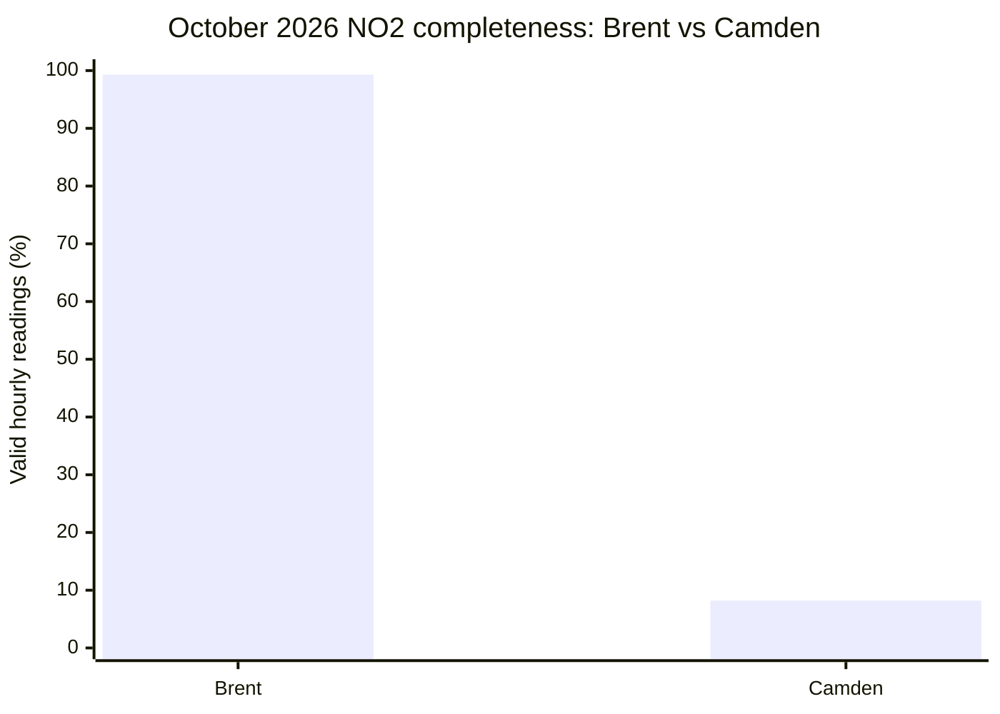
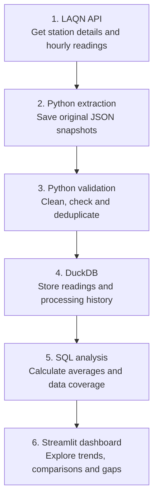
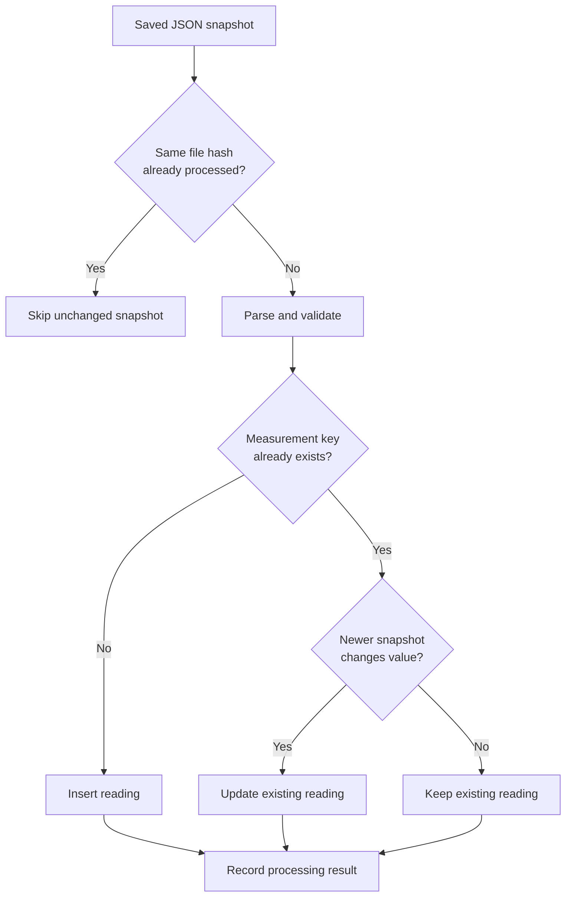
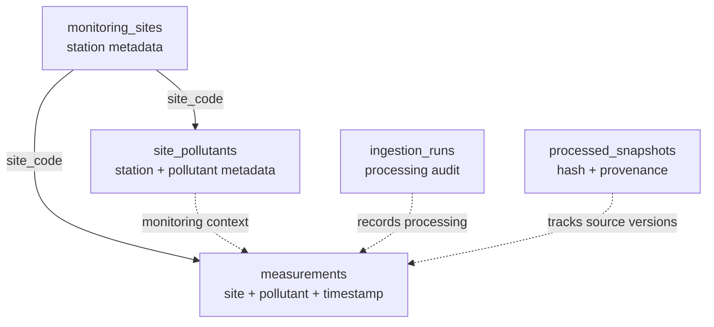

# AirLens London

**Explore London's historical air pollution with data quality in view.**

AirLens London is an end-to-end data engineering project that retrieves measurements from the [London Air Quality Network (LAQN)](https://www.londonair.org.uk/), preserves raw API responses, processes them with Python and DuckDB, and presents the results in an interactive Streamlit dashboard.

**The problem:** A station can appear to have a lower average pollution concentration simply because much of its data is missing. AirLens presents measurements **alongside coverage, monitoring status and freshness**, so comparisons are easier to interpret.

**Stack:** Python · REST API · JSON · DuckDB · SQL · pandas · Streamlit · Altair · pytest · GitHub Actions

## About me

I have a Master's degree in Integrated Engineering, covering mechanical, electrical and electronic engineering. This multidisciplinary background developed my interest in solving technical problems using structured and analytical approaches, as well as programming and working with data.

I am interested in data engineering because it combines technical problem-solving with transforming raw data into reliable and useful information.

I built AirLens London to explore this interest through an end-to-end data engineering project, from collecting and validating air quality measurements to data modelling, SQL analysis and creating an interactive dashboard.

## 01. What I built and who for

Air pollution can vary by location and over time. Someone comparing places near their home, regular commute or workplace may want to know whether pollution was consistently higher at one monitoring location, whether there were unusual days, or how levels changed over a week or month. Historical measurements help reveal these patterns rather than relying on a single reading. They do not measure any individual's personal exposure or predict the air quality of a particular journey.

AirLens lets London residents, commuters and anyone interested in air quality explore past readings at six monitoring stations. It focuses on nitrogen dioxide (NO₂) and particulate matter (PM₂.₅ and PM₁₀), pollutants associated with respiratory and wider health impacts. For background, see the [UK government's guide to air-pollution health effects](https://www.gov.uk/government/publications/health-effects-of-air-pollution/using-the-daily-air-quality-index-daqi).

A key question is not just **what was the average?** but **how many measurements were available to calculate it?** AirLens shows coverage beside concentrations because an average based on a handful of hours may be misleading.

Users can:

- Select **NO₂, PM₂.₅ or PM₁₀** and explore six London monitoring stations.
- Examine the most recently stored valid reading and its timestamp.
- Switch between **24-hour hourly charts** and **7-day or 30-day daily-average charts**.
- Compare selected stations using time-series charts and a bar chart of their average available hourly readings.
- Inspect valid/missing hours, percentage coverage, station type, monitoring status and data freshness.
- See warnings for limited coverage, and view written comparisons restricted to stations with **at least 75% coverage**.
- Optionally overlay the relevant **WHO 2021 24-hour guideline** on daily charts.

**Important:** AirLens compares specific monitoring locations, not whole boroughs. It is a historical exploration tool, not a live exposure monitor or personalized health-advice service.

### Why missing measurements matter

The following is a **fixed example from the locally verified October 2026 NO₂ analysis** (1 October inclusive to 1 November exclusive):

| Monitoring station | Average NO₂ (µg/m³) | Valid hourly readings | Completeness |
|---|---:|---:|---:|
| Brent, ARK Franklin Primary Academy | 21.72 | 739 / 744 | **99.3%** |
| Richmond, Barnes Wetlands | 11.51 | 739 / 744 | **99.3%** |
| Lambeth, Streatham Green | 14.94 | 738 / 744 | **99.2%** |
| Bexley, Belvedere West | 11.44 | 716 / 744 | **96.2%** |
| Camden, Bloomsbury | 14.26 | 61 / 744 | **8.2%** |
| Barking and Dagenham, Rush Green | N/A | 0 / 744 | **0.0%** |



Camden's reported average is lower than Brent's, but Camden has valid readings for only **61 of 744 hours**. The comparison is therefore much less informative than the averages alone suggest. A missing reading is **not** a zero concentration, and low coverage does not prove that a location is cleaner.

These figures are a reproducible example from a particular data snapshot; later LAQN corrections or refreshed periods may change them.

## 02. The data

**Source:** [London Air Quality Network](https://www.londonair.org.uk/), operated by Imperial College London's Environmental Research Group.

**API:** [LAQN Air Quality API documentation](https://api.erg.ic.ac.uk/AirQuality/help)

The pipeline retrieves three kinds of information:

| Dataset | Why it matters |
|---|---|
| Monitoring-site metadata | Names, local authorities and station environment/type |
| Site-pollutant metadata | Whether a pollutant is listed as monitored at a station |
| Historical hourly measurements | Timestamped concentrations, including unavailable readings |

### Six selected stations

These stations provide a small, manageable sample across different parts of London and monitoring environments. They were selected to explore contrasting locations and data availability, **not** as a representative sample of every London borough or as a ranking of neighborhoods.

A site's **environment** describes where its monitoring equipment samples air relative to pollution sources: *roadside* is close to traffic, while *urban background* and *suburban* stations reflect different surrounding settings. This can affect measured concentrations, but it does **not** explain why a station has missing data. LAQN's [site-type explanation](https://www.londonair.org.uk/LondonAir/Data-Visualisations/objectivevstime.aspx) provides more context.

| Code | Station | Environment |
|---|---|---|
| `BL0` | Camden, Bloomsbury | Urban background |
| `BG1` | Barking and Dagenham, Rush Green | Suburban |
| `BQ7` | Bexley, Belvedere West | Urban background |
| `BT8` | Brent, ARK Franklin Primary Academy | Roadside |
| `RI2` | Richmond, Barnes Wetlands | Suburban |
| `LB6` | Lambeth, Streatham Green | Urban background |

**Pollutants:** `NO2` (nitrogen dioxide), `PM25` (PM₂.₅ fine particulate matter) and `PM10` (PM₁₀ particulate matter). The pipeline requests all three for the selected stations. **Not every station is listed as monitoring every pollutant**, so the dashboard distinguishes *not listed as monitored* from *monitored but no valid readings*. The LAQN API can return empty placeholder rows even for unmonitored combinations.

For October 2026, there are **13,392 possible station-pollutant-hour combinations** (6 stations × 3 pollutants × 744 hours). This is the expected comparison grid, **not** a claim that all 13,392 combinations represent valid measurements or operating sensors. Some pollutants are not monitored at some stations, and unavailable readings may be `NULL`.

### Why coverage is important

Monitoring equipment operates in real-world conditions, so a complete series of valid readings is not guaranteed. LAQN explains that missing data can arise from **routine maintenance, calibration, power cuts, flooding, lightning and equipment faults**. Other monitoring guidance also discusses communication failures and readings being excluded during quality checks. These are **general possibilities**, not confirmed explanations for missing values at any of AirLens's six stations. See [LAQN's data-capture explanation](https://www.londonair.org.uk/LondonAir/Data-Visualisations/objectivevstime.aspx) and [UK air-monitoring quality guidance](https://www.gov.uk/guidance/monitoring-ambient-air-quality-control-and-quality-assurance).

A station that returns only a small number of valid hours may have an average that does not represent the full period. AirLens therefore displays the share of expected hours with valid measurements and flags low coverage rather than silently filling gaps.

### How coverage is measured

- **Expected hours:** Hours in the selected reporting period (for October 2026, 31 × 24 = 744 per station and pollutant).
- **Returned hours:** Measurement rows stored for the station and pollutant.
- **Valid hours:** Rows with usable numerical values; `COUNT(value)` ignores SQL `NULL`.
- **Missing hours:** Expected hours without a valid reading, including any hour with no returned row.
- **Completeness:** `valid hours / expected hours × 100`.

A station's completeness is a **data availability metric**, not a direct measurement of sensor uptime or official LAQN quality assurance. AirLens preserves unavailable values as `NULL` rather than turning them into zeros.

## 03. How it works

### End-to-end architecture

The flow runs **from top to bottom**, following the same order as the steps below. The raw-data copy is kept so the processing can be repeated or checked later.



**In one sentence:** AirLens downloads historical measurements, keeps the original responses, checks and stores the data, uses SQL to calculate meaningful summaries, and displays them with warnings about missing readings.

`run_pipeline.py` orchestrates extraction, transformation and a separate SQL analysis for **each of the three pollutants**. If a required script fails, the pipeline stops rather than reporting a successful run.

### Step 1: Extract and preserve source data

`src/extract.py` requests site metadata, site-pollutant metadata and hourly readings. It validates API responses, uses request timeouts and retries for temporary failures, and saves the original responses as JSON for inspection and reprocessing.

A normal extraction can reuse an existing response for the same request. When run with `--refresh`, it saves a **new timestamped JSON copy** rather than replacing the old one. This is useful because the source may later correct previously published measurements; keeping older versions lets the pipeline compare and reprocess them. The `--latest` option fetches recent data manually. Automatic scheduled collection is a future improvement.

### Step 2: Validate and transform

`src/transform.py` parses snapshots, validates values and timestamps, loads station metadata and measurements, and records ingestion results. Invalid/unavailable numerical measurements are not silently converted to zero.

**Repeatable ingestion (idempotency)** means that processing the same data twice should not create duplicate measurements. AirLens identifies each measurement using:

```sql
PRIMARY KEY (site_code, pollutant_code, measured_at)
```

Snapshots are tracked by file hash, and source snapshot order matters when historical measurements are corrected. Newer snapshots can update previous readings, including replacing a previous numeric value with a newly missing value. Transactions help avoid partially committed ingestion runs.

#### Checking repeat runs and corrections

The `ingestion_runs` table records how many observations were inserted, updated, unchanged or rejected. A repeat run previously processed **6,240 unchanged observations** across saved snapshots without creating duplicates; the database then held **2,304 unique measurement rows**. These numbers refer to an earlier development run, not the current October dataset.

A separate incremental check confirmed **6 inserted**, **3 updated** and **393 unchanged** observations. This matters because newer source snapshots may correct historical values, while unchanged data should not be duplicated.



*Simplified processing logic. The actual transformation also handles metadata, snapshot provenance, validation and database transactions.*

### Step 3: Store data in DuckDB

DuckDB was chosen because it supports SQL joins, grouping and aggregations directly from a local Python project without running a separate database server. This kept the initial deployment simple while still providing relational modelling and a reproducible analysis workflow. AirLens uses five tables:

| Table | Purpose |
|---|---|
| `monitoring_sites` | Station names, local authorities and station types |
| `site_pollutants` | Station-pollutant metadata and monitoring information |
| `measurements` | Hourly pollutant measurements and timestamps |
| `ingestion_runs` | Counts and results of processing runs |
| `processed_snapshots` | Processed file hashes and snapshot provenance |



*Logical overview; dashed connections describe relationships used by the application and ingestion process, not necessarily enforced foreign keys.*

### Step 4: Analyse with SQL

`src/analyse.py` joins measurements to monitoring-site metadata and groups readings by station and pollutant. It calculates the average concentration, returned and valid hours, missing values in stored rows, expected hours and completeness.

For example, the SQL uses:

```sql
COUNT(*)          -- All stored measurement rows, including NULL values
COUNT(m.value)    -- Rows with a valid, non-NULL measurement
AVG(m.value)      -- Mean of valid measurements only
```

It filters with parameterized dates and pollutant codes and uses `NULLIF` to avoid dividing by zero when calculating percentages. The analysis is read-only, so it cannot modify the stored measurements.

### Step 5: Explore results in Streamlit

`app.py` reads the DuckDB database in **read-only mode**. It does **not** contact the API or update measurements automatically.

The dashboard includes:

1. **Station explorer:** Select a pollutant and station; see the latest stored valid reading, its timestamp, the station type and selected-period coverage.
2. **Historical trends:** Hourly readings for 24 hours, or daily means for 7 or 30 completed UTC days. Gaps remain visible instead of being filled with zeros.
3. **Multi-station comparisons:** Compare selected stations on a shared chart and compare averages of their available hourly readings.
4. **Interpretation:** A written highest-versus-lowest comparison only uses selected stations with **at least 75% coverage**; low-coverage stations remain visible in other checks.
5. **Transparent underlying data:** Tables and coverage charts show all six stations, including missing readings and stations not listed as monitoring the selected pollutant.

Historical chart windows are anchored to the **newest stored timestamp** for the selected pollutant. The separate *latest reading* indicator uses the most recent valid value stored for that station, which may be older. The dashboard explicitly labels historical data as **not live**.

### Coverage, freshness and WHO references

| Valid-hour coverage | AirLens classification |
|---|---|
| At least 90% | Good coverage |
| 75% to below 90% | Moderate coverage |
| Above 0% to below 75% | Low coverage |
| 0% | No valid data |

These thresholds are **AirLens project rules**, not official LAQN classifications. The detailed table labels a reading as *recent* when it falls within the final two days of the selected reporting period; the station's latest-reading card separately checks age relative to the current UTC time. Neither label means that the dashboard provides live readings.

The dashboard can show the following **WHO 2021 24-hour guideline references** on daily charts:

| Pollutant | 24-hour reference |
|---|---:|
| NO₂ | 25 µg/m³ |
| PM₂.₅ | 15 µg/m³ |
| PM₁₀ | 45 µg/m³ |

Daily means are shown only for **completed UTC days with at least 18 valid hourly readings**. The 18-hour rule is a project-defined data-coverage requirement. WHO's 24-hour references are **not hourly limits**; their guideline framework considers the **99th percentile of daily means over a year**, so a single day's value should not be treated as a simple regulatory pass/fail or personal safety assessment.

Sources: [WHO air-quality guideline table](https://www.ncbi.nlm.nih.gov/books/NBK574591/table/ch3.tab21/) · [LAQN](https://www.londonair.org.uk/)


## 04. How to run it

AirLens London can be run locally using Python, DuckDB and Streamlit. The pipeline collects measurements from the LAQN API, processes them into a local database and produces SQL analysis that can be explored through the dashboard.

**Requirements:** Python, Git and an internet connection for API requests. GitHub Actions uses Python 3.12, while local development has also used Python 3.14. No API key is required.

### Step 1. Set up the project (first time only)

Clone the repository:

```powershell
git clone https://github.com/parvathysn10/AirLens-London.git
cd AirLens-London
```

Create and activate a virtual environment:

```powershell
python -m venv .venv
.venv\Scripts\Activate.ps1
```

Install the dependencies:

```powershell
python -m pip install -r requirements.txt
```

If the project is already set up and the terminal shows `(.venv)`, skip this step.

### Step 2. Run the automated tests

```powershell
python -m pytest -q
```

The latest previously verified local run passed 12 pytest tests. These cover:

- API errors, invalid responses and measurement validation.
- Data completeness, missing values and freshness calculations.
- Repeat ingestion, duplicate prevention and updated historical readings.
- Daily summaries and support for NO2, PM25 and PM10.

The GitHub Actions workflow at `.github/workflows/tests.yml` also runs automated tests using Python 3.12 on pushes and pull requests.

### Step 3. Inspect the existing database

```powershell
python scripts/verify_database.py
```

This read-only verification script reports:

- Whether any duplicate measurement keys exist.
- The earliest and latest stored NO2 readings for each station.
- The number of stored and valid NO2 readings by station.
- Whether historical measurements exist for 8 October 2026.
- The total number of measurement records.

Record the total row count before running the pipeline so you can compare it afterward.

### Step 4. Retrieve the latest measurements

```powershell
python run_pipeline.py --latest
```

This command runs the complete pipeline for today and the previous two UTC days, using an exclusive end date of tomorrow.

The pipeline:

1. Calls `src/extract.py` to request fresh LAQN data and save timestamped raw JSON snapshots.
2. Calls `src/transform.py` to validate and load the data into DuckDB.
3. Calls `src/analyse.py` separately for NO2, PM25 and PM10 to calculate station-level statistics.

The pipeline stops if a required stage fails.

**Note:** `--latest` automatically requests fresh snapshots. It does not need to be combined with `--refresh`. This command is run manually; data collection is not currently scheduled.

### Step 5. Run the pipeline again to check repeatability

```powershell
python run_pipeline.py --latest
```

Running the same pipeline twice should not create duplicate measurement records.

Each measurement is identified by its station code, pollutant code and timestamp. If an incoming measurement already exists, the transformation logic checks whether it should remain unchanged or be updated with a newer source value.

New measurements may be inserted, and corrected historical values may be updated, but the same measurement key should not be stored twice.

### Step 6. Verify the database after rerunning

```powershell
python scripts/verify_database.py
```

Compare the results with Step 3.

The key check is:

```text
Duplicate keys: 0
PASS: No duplicate measurement keys.
```

The total row count may increase if the API has supplied genuinely new measurements. An increase does not mean duplicates have been created.

If the same data was already stored and no corrections or new measurements were returned, the total row count should remain unchanged.

### Step 7. Launch the dashboard

```powershell
python -m streamlit run app.py
```

Open the local address shown in the terminal, usually `http://localhost:8501`.

In the dashboard, users can:

- Select NO2, PM25 or PM10 and explore monitoring stations.
- View the latest stored valid reading and its timestamp.
- Explore hourly and daily historical trends.
- Compare measurements between selected stations.
- Inspect missing readings, completeness, freshness and monitoring status.
- View WHO 2021 daily guideline references where applicable.

The dashboard reads the local DuckDB database. It does not automatically contact the API, so reload it after collecting new data.

### Optional: Run a specific historical period

To collect and analyse the full October 2026 period:

```powershell
python run_pipeline.py --start 2026-10-01 --end 2026-11-01
```

The end date is exclusive. This requests data from 1 October up to, but not including, 1 November.

Without date arguments, the pipeline currently defaults to 1–24 October 2026.

To request new versions of the October measurements, while preserving earlier raw snapshots:

```powershell
python run_pipeline.py --start 2026-10-01 --end 2026-11-01 --refresh
```

Timestamped snapshots allow earlier responses to be retained and historical corrections to be processed.

### Optional: Run individual pipeline stages

For troubleshooting, the stages can be run separately.

Extract historical measurements:

```powershell
python src/extract.py --start 2026-10-01 --end 2026-11-01
```

Transform saved raw snapshots into DuckDB:

```powershell
python src/transform.py
```

Analyse NO2 measurements using SQL:

```powershell
python src/analyse.py --start 2026-10-01 --end 2026-11-01 --pollutant NO2
```

The analysis script also accepts `PM25` and `PM10`.

The processed DuckDB database is stored locally and is not intended to be committed to GitHub. It can be rebuilt from available saved raw snapshots by running `python src/transform.py`.

### Continuous integration

The existing GitHub Actions workflow automatically runs the project's tests when code is pushed or a pull request is opened.

It currently checks code behavior only. It does not automatically collect new LAQN measurements, update the stored database or deploy the Streamlit dashboard. These are possible future improvements.


## 05. What I would do next

### Current limitations

- Only **six selected monitoring stations** and three pollutants are included; station readings are not borough-wide estimates.
- Not every station monitors every pollutant, and some returned measurement series have substantial gaps.
- Coverage measures availability of numerical readings, not instrument uptime or official data-quality certification.
- Missing values may bias averages; AirLens does not statistically impute missing observations.
- The database and dashboard are local. The dashboard is **not deployed publicly** and does not fetch live readings.
- Refreshes must be triggered manually; raw snapshots can increase storage use over time.
- The WHO references provide general context, not regulatory compliance determinations or personal medical advice.

### Future improvements

1. **Public website:** Deploy the Streamlit dashboard with hosted data so people can explore AirLens without running Python locally.
2. **Automated data updates:** Schedule the existing `--latest` pipeline using a workflow or another scheduler, with safe access to persistent storage and alerts when a run fails. The current GitHub Actions workflow runs **tests only**, not ingestion or deployment.
3. **More testing and CI checks:** Expand tests for malformed API responses, transaction failures, date boundaries and dashboard behavior; add code-quality checks and a build/deployment workflow when appropriate.
4. **More context from other APIs:** Combine pollution measurements with weather data, such as wind, temperature and rainfall, to investigate possible relationships without assuming causation.
5. **More stations and a map:** Add geographical comparisons and longer seasonal trends, while distinguishing roadside from background locations.
6. **Better monitoring and storage:** Track data delays and unusually low coverage, and archive old snapshots while preserving provenance.


## 06. Where AI helped

I used AI as a development tool to help understand the LAQN API structure, troubleshoot Python and DuckDB errors, and explore approaches to data cleaning, modelling and testing. I checked suggestions against the actual API responses and database results, then adapted and improved the implementation as the project developed. For example:

- I added data completeness and freshness checks after discovering that some monitoring stations had very few valid readings, making their averages potentially misleading.
- I improved the database logic to prevent duplicate measurements when rerunning the pipeline and to handle corrections to historical readings.
- I added timestamped raw JSON snapshots to preserve earlier API responses when refreshing data, rather than overwriting them.
- I ensured missing measurements were preserved as `NULL` rather than zero, so they would not artificially lower calculated averages.
- I tested the pipeline using SQL queries, repeat ingestion checks and automated tests, and added GitHub Actions to check the code when changes are pushed.


## Data attribution and licence

This information has been obtained from the Environmental Research Group of Imperial College London, using data from the [London Air Quality Network](https://www.londonair.org.uk/). The source data is licensed under the [Open Government Licence, version 2](https://www.nationalarchives.gov.uk/doc/open-government-licence/version/2/). See the [ERG API documentation](https://api.erg.ic.ac.uk/AirQuality/Information/Documentation/pdf) for the source's terms and attribution guidance.
