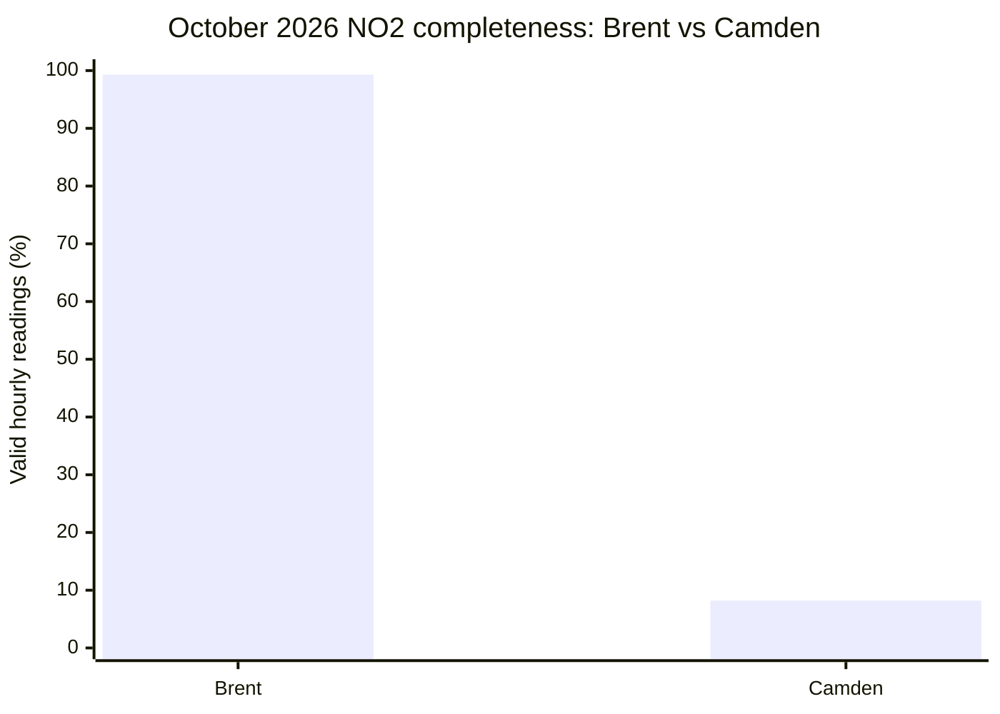
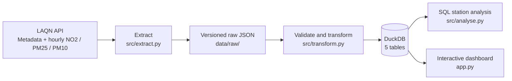
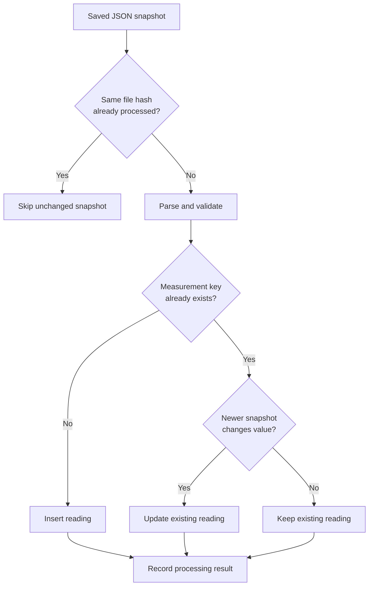
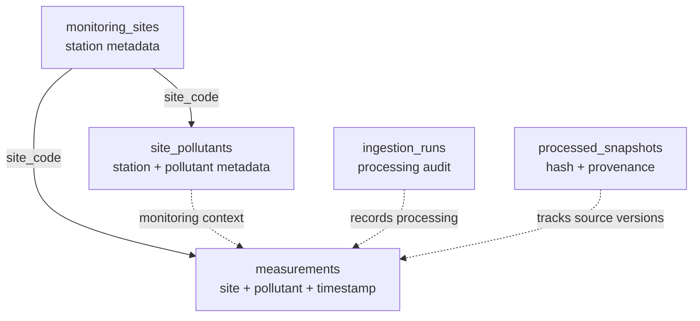

# AirLens London

**Explore London's historical air pollution with data quality in view.**

AirLens London is an end-to-end data engineering project that retrieves measurements from the [London Air Quality Network (LAQN)](https://www.londonair.org.uk/), preserves raw API responses, processes them with Python and DuckDB, and presents the results in an interactive Streamlit dashboard.

**The problem:** A station can appear to have a lower average pollution concentration simply because much of its data is missing. AirLens presents measurements **alongside coverage, monitoring status and freshness**, so comparisons are easier to interpret.

**Stack:** Python · REST API · JSON · DuckDB · SQL · pandas · Streamlit · Altair · pytest · GitHub Actions

## About me

I graduated from Cardiff University with an MEng in Integrated Engineering (2:1), covering electrical, electronic and mechanical engineering. My multidisciplinary background developed my interest in programming, analytical problem-solving and using data to understand real-world systems.

I am particularly interested in data engineering because it combines programming and technical problem-solving with the challenge of transforming raw, sometimes unreliable data into useful information.

I am applying to The Information Lab because I want to develop these skills through practical projects, structured learning and experience solving real business problems.

I built AirLens London to demonstrate this interest through a complete data engineering workflow, from API extraction and validation to relational data modelling, SQL analysis, automated testing and an interactive dashboard.

## 01. What I built and who for

AirLens is designed for residents, commuters and curious Londoners who want to explore **historical measurements at individual monitoring stations**, rather than make decisions from a pollution average alone.

Users can:

- Select **NO₂, PM₂.₅ or PM₁₀** and explore six London monitoring stations.
- Examine the most recently stored valid reading and its timestamp.
- Switch between **24-hour hourly charts** and **7-day or 30-day daily-average charts**.
- Compare selected stations using time-series charts and a bar chart of their average available hourly readings.
- Inspect valid/missing hours, percentage coverage, station type, monitoring status and data freshness.
- See warnings for limited coverage, and view written comparisons restricted to stations with **at least 75% coverage**.
- Optionally overlay the relevant **WHO 2021 24-hour guideline** on daily charts.

**Important:** AirLens compares specific monitoring locations, not whole boroughs. It is a historical exploration tool, not a live exposure monitor or personalized health-advice service.

### Why completeness changes the story

The following is a **fixed example from the locally verified October 2026 NO₂ analysis** (1 October inclusive to 1 November exclusive):

| Monitoring station | Average NO₂ (µg/m³) | Valid hourly readings | Completeness |
|---|---:|---:|---:|
| Brent, ARK Franklin Primary Academy | 21.72 | 739 / 744 | **99.3%** |
| Richmond, Barnes Wetlands | 11.51 | 739 / 744 | **99.3%** |
| Lambeth, Streatham Green | 14.94 | 738 / 744 | **99.2%** |
| Bexley, Belvedere West | 11.44 | 716 / 744 | **96.2%** |
| Camden, Bloomsbury | 14.26 | 61 / 744 | **8.2%** |
| Barking and Dagenham, Rush Green | N/A | 0 / 744 | **0.0%** |



Camden's reported average is lower than Brent's, but Camden has valid readings for only **61 of 744 hours**. The comparison is therefore much less informative than the averages alone suggest. A missing reading is **not** a zero concentration, and low coverage does not prove that a location is cleaner.

These figures are a reproducible example from a particular data snapshot; later LAQN corrections or refreshed periods may change them.

## 02. Data source and scope

**Source:** [London Air Quality Network](https://www.londonair.org.uk/), operated by Imperial College London's Environmental Research Group.
**API:** [LAQN Air Quality API documentation](https://api.erg.ic.ac.uk/AirQuality/help)

The pipeline retrieves three kinds of information:

| Dataset | Why it matters |
|---|---|
| Monitoring-site metadata | Names, local authorities and station environment/type |
| Site-pollutant metadata | Whether a pollutant is listed as monitored at a station |
| Historical hourly measurements | Timestamped concentrations, including unavailable readings |

### Six selected stations

| Code | Station | Environment |
|---|---|---|
| `BL0` | Camden, Bloomsbury | Urban background |
| `BG1` | Barking and Dagenham, Rush Green | Suburban |
| `BQ7` | Bexley, Belvedere West | Urban background |
| `BT8` | Brent, ARK Franklin Primary Academy | Roadside |
| `RI2` | Richmond, Barnes Wetlands | Suburban |
| `LB6` | Lambeth, Streatham Green | Urban background |

**Pollutants:** `NO2` (nitrogen dioxide), `PM25` (PM₂.₅ fine particulate matter) and `PM10` (PM₁₀ particulate matter). The pipeline requests all three for the selected stations. **Not every station is listed as monitoring every pollutant**, so the dashboard distinguishes *not listed as monitored* from *monitored but no valid readings*. The LAQN API can return empty placeholder rows even for unmonitored combinations.

For the fixed October 2026 dataset, the database contained **13,392 hourly measurement rows across the three pollutants** (6 stations × 3 pollutants × 744 hours). Some rows have `NULL` values. This row count is **not** a count of valid measurements or operating sensors.

### How coverage is measured

- **Expected hours:** Hours in the selected reporting period (for October 2026, 31 × 24 = 744 per station and pollutant).
- **Returned hours:** Measurement rows stored for the station and pollutant.
- **Valid hours:** Rows with usable numerical values; `COUNT(value)` ignores SQL `NULL`.
- **Missing hours:** Expected hours without a valid reading, including any hour with no returned row.
- **Completeness:** `valid hours / expected hours × 100`.

A station's completeness is a **data availability metric**, not a direct measurement of sensor uptime or official LAQN quality assurance. AirLens preserves unavailable values as `NULL` rather than turning them into zeros.

## 03. How AirLens works

### End-to-end architecture



`run_pipeline.py` orchestrates extraction, transformation and a separate SQL analysis for **each of the three pollutants**. If a required script fails, the pipeline stops rather than reporting a successful run.

### Step 1: Extract and preserve source data

`src/extract.py` requests site metadata, site-pollutant metadata and hourly readings. It validates API responses, uses request timeouts and retries for temporary failures, and saves the original responses as JSON for inspection and reprocessing.

A normal extraction can reuse an existing file for the same request, avoiding unnecessary API calls. With `--refresh`, new responses are saved as **timestamped snapshots**, preserving earlier versions instead of overwriting them. For example:

```text
BL0_NO2_2026-10-01_2026-10-08.json
BL0_NO2_2026-10-01_2026-10-08_20261025T183036869744Z.json
```

Both files describe the same requested period, but the second is a later retrieval. Keeping both makes it possible to inspect the original data and compare it with subsequent corrections. The `--latest` mode explicitly fetches fresh snapshots for the current UTC day and preceding two days. Refreshing is currently manual, not scheduled.

### Step 2: Validate and transform

`src/transform.py` parses snapshots, validates values and timestamps, loads station metadata and measurements, and records ingestion results. Invalid/unavailable numerical measurements are not silently converted to zero.

**A key design choice is idempotency:** rerunning the same data should not duplicate measurements. The unique measurement key is:

```sql
PRIMARY KEY (site_code, pollutant_code, measured_at)
```

Snapshots are tracked by file hash, and source snapshot order matters when historical measurements are corrected. Newer snapshots can update previous readings, including replacing a previous numeric value with a newly missing value. Transactions help avoid partially committed ingestion runs.

#### Ingestion logging and repeatability

Each transformation run records inserted, updated, unchanged and rejected observations in `ingestion_runs`. An earlier development run produced:

```text
INGESTION SUMMARY
Inserted: 0
Updated: 0
Unchanged: 6240
Rejected: 0

DATABASE SUMMARY
monitoring_sites: 258 rows
site_pollutants: 646 rows
measurements: 2304 rows
ingestion_runs: 7 rows
```

**This is a historical example, not the current database size.** The 6,240 unchanged observations were encountered while processing multiple saved snapshots; they were **not 6,240 distinct measurement keys**. At that point, only 2,304 unique measurements were stored. This demonstrates why counting processing events is different from counting unique database records. A separate verified incremental test later inserted **6** readings, updated **3** and left **393** unchanged, showing that historical corrections can also be applied.



*Simplified processing logic. The actual transformation also handles metadata, snapshot provenance, validation and database transactions.*

### Step 3: Store data in DuckDB

DuckDB was chosen because it supports SQL joins, grouping and aggregations directly from a local Python project without running a separate database server. This kept the initial deployment simple while still providing relational modelling and a reproducible analysis workflow. AirLens uses five tables:

| Table | Purpose |
|---|---|
| `monitoring_sites` | Station names, local authorities and station types |
| `site_pollutants` | Station-pollutant metadata and monitoring information |
| `measurements` | Hourly pollutant measurements and timestamps |
| `ingestion_runs` | Counts and results of processing runs |
| `processed_snapshots` | Processed file hashes and snapshot provenance |



*Logical overview; dashed connections describe relationships used by the application and ingestion process, not necessarily enforced foreign keys.*

### Step 4: Analyse with SQL

`src/analyse.py` joins measurements to monitoring-site metadata and groups readings by station and pollutant. It calculates the average concentration, returned and valid hours, missing values in stored rows, expected hours and completeness.

For example, the SQL uses:

```sql
COUNT(*)          -- All stored measurement rows, including NULL values
COUNT(m.value)    -- Rows with a valid, non-NULL measurement
AVG(m.value)      -- Mean of valid measurements only
```

It filters with parameterized dates and pollutant codes and uses `NULLIF` to avoid dividing by zero when calculating percentages. The analysis is read-only, so it cannot modify the stored measurements.

### Step 5: Explore results in Streamlit

`app.py` reads the DuckDB database in **read-only mode**. It does **not** contact the API or update measurements automatically.

The dashboard includes:

1. **Station explorer:** Select a pollutant and station; see the latest stored valid reading, its timestamp, the station type and selected-period coverage.
2. **Historical trends:** Hourly readings for 24 hours, or daily means for 7 or 30 completed UTC days. Gaps remain visible instead of being filled with zeros.
3. **Multi-station comparisons:** Compare selected stations on a shared chart and compare averages of their available hourly readings.
4. **Interpretation:** A written highest-versus-lowest comparison only uses selected stations with **at least 75% coverage**; low-coverage stations remain visible in other checks.
5. **Transparent underlying data:** Tables and coverage charts show all six stations, including missing readings and stations not listed as monitoring the selected pollutant.

Historical chart windows are anchored to the **newest stored timestamp** for the selected pollutant. The separate *latest reading* indicator uses the most recent valid value stored for that station, which may be older. The dashboard explicitly labels historical data as **not live**.

### Coverage, freshness and WHO references

| Valid-hour coverage | AirLens classification |
|---|---|
| At least 90% | Good coverage |
| 75% to below 90% | Moderate coverage |
| Above 0% to below 75% | Low coverage |
| 0% | No valid data |

These thresholds are **AirLens project rules**, not official LAQN classifications. The detailed table labels a reading as *recent* when it falls within the final two days of the selected reporting period; the station's latest-reading card separately checks age relative to the current UTC time. Neither label means that the dashboard provides live readings.

The dashboard can show the following **WHO 2021 24-hour guideline references** on daily charts:

| Pollutant | 24-hour reference |
|---|---:|
| NO₂ | 25 µg/m³ |
| PM₂.₅ | 15 µg/m³ |
| PM₁₀ | 45 µg/m³ |

Daily means are shown only for **completed UTC days with at least 18 valid hourly readings**. The 18-hour rule is a project-defined data-coverage requirement. WHO's 24-hour references are **not hourly limits**; their guideline framework considers the **99th percentile of daily means over a year**, so a single day's value should not be treated as a simple regulatory pass/fail or personal safety assessment.

Sources: [WHO air-quality guideline table](https://www.ncbi.nlm.nih.gov/books/NBK574591/table/ch3.tab21/) · [LAQN](https://www.londonair.org.uk/)

## 04. Run the project locally

**Requirements:** Python (the GitHub Actions test workflow uses **3.12**; local development has also used **3.14**), Git and internet access for new API downloads. No LAQN API key is required for this project.

### 1. Clone and install

```powershell
git clone https://github.com/parvathysn10/AirLens-London.git
cd AirLens-London
python -m venv .venv
.venv\Scripts\Activate.ps1
python -m pip install -r requirements.txt
```

### 2. Run the pipeline

For the fixed October 2026 reporting period:

```powershell
python run_pipeline.py --start 2026-10-01 --end 2026-11-01
```

The `--end` date is **exclusive**. Without date arguments, the current script uses its original historical default of **1–24 October 2026** (end date `2026-10-25`). For a specific period, pass both dates explicitly.

To fetch fresh measurements for **today and the previous two UTC days**:

```powershell
python run_pipeline.py --latest
```

To request fresh versions of a historical period without overwriting earlier raw snapshots:

```powershell
python run_pipeline.py --start 2026-10-01 --end 2026-11-01 --refresh
```

**Important:** `--latest` is a **manual command**, not a scheduled job. New data will only appear if the LAQN API has published it.

### Run each pipeline stage separately

For troubleshooting, each script can be run independently:

```powershell
python src/extract.py --start 2026-10-01 --end 2026-11-01
python src/transform.py
python src/analyse.py --start 2026-10-01 --end 2026-11-01 --pollutant NO2
```

The analysis script accepts `NO2`, `PM25` or `PM10`. Running a stage separately helps isolate API extraction, database ingestion and SQL-analysis problems.

### 3. Launch the dashboard

```powershell
python -m streamlit run app.py
```

Open the local URL printed in the terminal. After running a data refresh, rerun or reload the dashboard to see the updated database.

### 4. Run automated tests and verify the database

```powershell
python -m pip install pytest
python -m pytest -q
python scripts/verify_database.py
```

**Latest local check:** **12 pytest tests passed**. The tests cover API failure handling, numerical validation, coverage and freshness, snapshot priority, historical corrections, idempotency, daily averages and multi-pollutant behavior. Additional standalone test scripts are included under `tests/`; the 12-test count refers specifically to tests collected by pytest.

**Continuous integration:** `.github/workflows/tests.yml` runs the automated tests using **GitHub Actions** on pushes and pull requests with Python 3.12. This tests code changes on a separate machine. It **does not** schedule API collection, refresh the database or deploy the dashboard.

The processed DuckDB database is generated locally and is not intended to be committed. It can be rebuilt from available saved raw snapshots using:

```powershell
python src/transform.py
```

Rebuilding from the saved snapshots is different from downloading new data from LAQN.

## 05. What I learned, limitations and next steps

### Engineering decisions and lessons

- **Preserve the raw data:** Keeping original API responses makes transformations auditable and allows later reprocessing.
- **Treat missingness as information:** `NULL` values and explicit coverage metrics prevent misleading comparisons.
- **Design for reruns and corrections:** Composite keys, snapshot hashes, version precedence and transactions help keep repeated ingestion reliable.
- **Test outside the development machine:** GitHub Actions runs the test suite on every push and pull request.
- **Keep the interface understandable:** Users see monitoring status and coverage alongside charts, rather than just a ranking of pollution averages.

### Current limitations

- Only **six selected monitoring stations** and three pollutants are included; station readings are not borough-wide estimates.
- Not every station monitors every pollutant, and some returned measurement series have substantial gaps.
- Coverage measures availability of numerical readings, not instrument uptime or official data-quality certification.
- Missing values may bias averages; AirLens does not statistically impute missing observations.
- The database and dashboard are local. The dashboard is **not deployed publicly** and does not fetch live readings.
- Refreshes must be triggered manually; raw snapshots can increase storage use over time.
- The WHO references provide general context, not regulatory compliance determinations or personal medical advice.

### Future improvements

1. **Scheduled ingestion:** Run `--latest` automatically on a daily schedule, with appropriate retries and failure notifications.
2. **Hosted dashboard and database refresh:** Deploy Streamlit and arrange for newly ingested data to become available to the hosted app.
3. **Monitoring and alerting:** Detect stalled ingestion, outdated station data, unusual missingness and failed scheduled runs.
4. **Broader test coverage:** Add more malformed API payloads, date-range validation, transaction rollback and dashboard edge-case tests.
5. **Geographic and longer-term analysis:** Expand station coverage, add a map and investigate seasonal patterns and weather relationships, while retaining coverage checks.
6. **Storage management:** Introduce an explicit retention/archiving policy for older raw snapshots without losing important provenance.

## 06. Where AI helped

I used AI as a **development and learning tool** to understand the LAQN API structure, troubleshoot Python and DuckDB issues, explore data-cleaning and modelling approaches, improve code comments and review possible tests. I tested suggestions against actual API responses, local pipeline runs, database queries and automated tests, and adapted the implementation as I learned more about the data.

Examples of decisions I investigated and verified include:

- Adding coverage and freshness checks after discovering that some stations had very few valid readings and could produce misleading averages.
- Preserving missing values as `NULL`, not zero, so calculations do not understate pollution.
- Preventing duplicate measurement keys on repeated runs and handling corrected historical readings.
- Retaining timestamped JSON snapshots rather than overwriting earlier API responses.
- Testing the resulting behavior using actual database queries, regression tests and GitHub Actions.

I can explain these design choices, the code behind them and the limitations of the resulting analysis.

The project, its scope and its limitations are explained here so the implementation can be inspected and discussed rather than treated as a black box.
