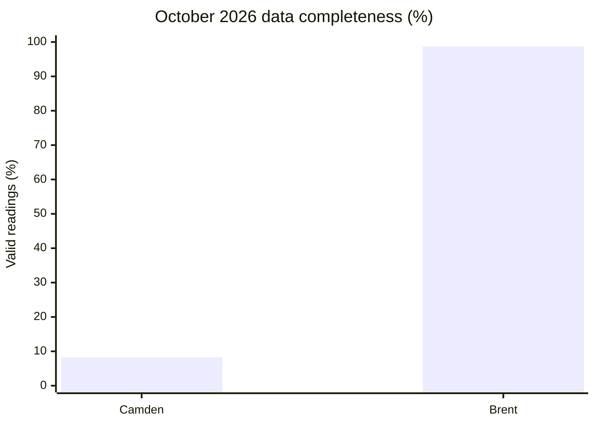
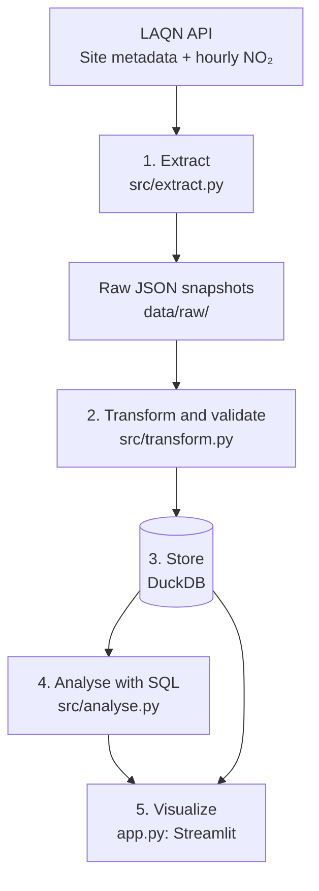
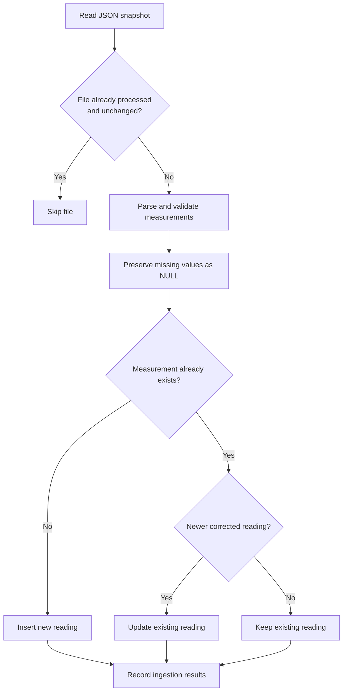
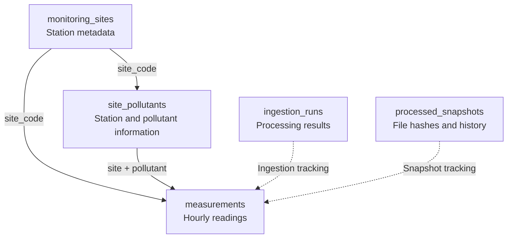
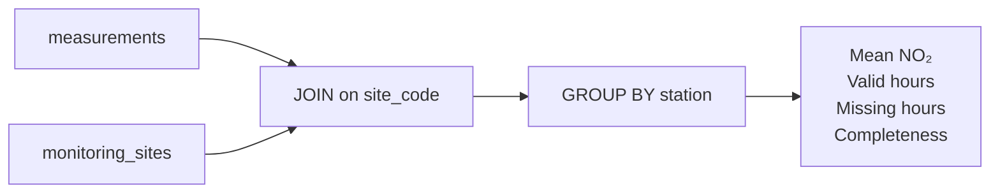

# AirLens London

**Exploring London's air quality through reliable, transparent data.**

AirLens London is an end-to-end data engineering project that collects nitrogen dioxide (NO₂) measurements from the London Air Quality Network (LAQN), processes them using Python and DuckDB, and presents them through an interactive Streamlit dashboard.

The key idea is simple: **a low pollution average can be misleading if most measurements are missing.** AirLens shows pollution levels alongside data completeness to help users understand and compare air quality measurements.

**Technologies:** Python | REST API | DuckDB | SQL | Pandas | Streamlit | Pytest

## About me

I have a Master's degree in Integrated Engineering, covering mechanical, electrical and electronic engineering. This multidisciplinary background developed my interest in solving technical problems using structured and analytical approaches, as well as programming and working with data.

I am interested in data engineering because it combines technical problem-solving with transforming raw data into reliable and useful outputs. I am applying to The Information Lab to develop these skills further through practical projects, continuous learning and exposure to real-world data problems.

I built AirLens London to explore this interest through an end-to-end project, from extracting and validating air quality measurements to data modelling, SQL analysis and an interactive dashboard.

---

## 1. What I built and who for

I built AirLens London for people who want to understand air quality in the places they live, work or travel through. The dashboard lets users compare NO₂ levels across monitoring stations, explore changes over time and see how complete and up to date the measurements are.

One important consideration is that pollution averages can be misleading when measurements are missing.

For example, comparing two London monitoring stations in October 2026:

| October 2026 | Camden | Brent |
|---|---:|---:|
| Average NO₂ | 14.26 µg/m³ | 21.57 µg/m³ |
| Valid hourly readings | 61 / 744 | 734 / 744 |
| Data completeness | **8.2%** | **98.7%** |



Camden appears to have lower NO₂ levels, but its average is based on only 8.2% of the expected measurements. **Without this context, users could draw misleading conclusions.**

This is why AirLens shows data completeness alongside pollution levels, helping users understand how much confidence to place in the comparisons.
### What users can do

- Compare NO₂ measurements across six London monitoring stations.
- Explore trends over 24 hours, 7 days or 30 days.
- View data completeness, missing readings and freshness.
- Exclude low-coverage stations from selected comparisons.
- Compare daily NO₂ averages against a WHO guideline reference.

AirLens compares individual monitoring stations, not entire boroughs.

---

## 2. The data

**Source:** [London Air Quality Network (LAQN)](https://www.londonair.org.uk/), operated by Imperial College London's Environmental Research Group.

**API:** https://api.erg.ic.ac.uk/AirQuality

The pipeline retrieves monitoring-site metadata, pollutant information and hourly NO₂ measurements.

### Selected stations

| Code | Monitoring station |
|---|---|
| BL0 | Camden: Bloomsbury |
| BG1 | Barking and Dagenham: Rush Green |
| BQ7 | Bexley: Belvedere West |
| BT8 | Brent: ARK Franklin Primary Academy |
| RI2 | Richmond: Barnes Wetlands |
| LB6 | Lambeth: Streatham Green |

### October 2026 results

**Period:** 1 to 31 October 2026  
**Expected:** 744 hourly readings per station  
**Stored:** 4,434 unique station-hour records

| Station | Mean NO₂ (µg/m³) | Valid hours | Completeness |
|---|---:|---:|---:|
| Lambeth | 14.90 | 737 | 99.1% |
| Brent | 21.57 | 734 | 98.7% |
| Richmond | 11.37 | 734 | 98.7% |
| Bexley | 11.36 | 711 | 95.6% |
| Camden | 14.26 | 61 | 8.2% |
| Barking and Dagenham | N/A | 0 | 0.0% |

**Completeness (%) = Valid hourly readings / Expected hourly readings × 100**

Missing or invalid numerical measurements are stored as `NULL`, not zero. SQL averages exclude these values.

Barking and Dagenham's missing average does not mean pollution was zero.

---

## 3. How it works

### Pipeline overview



`run_pipeline.py` runs the extraction, transformation and analysis stages in sequence.

### 1. Extract: `src/extract.py`

Retrieves data from the LAQN API and saves the original responses as JSON.

- Handles request timeouts and temporary API errors using retries.
- Preserves raw responses for reproducibility.
- Saves refreshed responses as separate snapshots rather than overwriting earlier files.

### 2. Transform and validate: `src/transform.py`

Parses the raw JSON, validates measurements and loads them into DuckDB.



**Key design decisions:**

- **Validation:** Rejects unusable numerical values without treating missing data as zero.
- **Deduplication:** Uses station, pollutant and timestamp as the unique measurement key.
- **Incremental processing:** SHA-256 hashes identify previously processed snapshots.
- **Historical corrections:** Newer data can update existing measurements.
- **Transactions:** Protect the database from partial ingestion.

### 3. Store: DuckDB

The database contains five tables:



*Simplified logical diagram. Dashed lines represent processing and snapshot tracking rather than enforced foreign keys.*

| Table | Purpose |
|---|---|
| `monitoring_sites` | Station names and metadata |
| `site_pollutants` | Pollutants monitored at each station |
| `measurements` | Hourly measurements and timestamps |
| `ingestion_runs` | Insert, update and processing counts |
| `processed_snapshots` | Processed file hashes and provenance |

The `measurements` table uses a composite primary key: `(site_code, pollutant_code, measured_at)`.

### 4. Join and analyse: `src/analyse.py`

SQL joins measurements to station metadata and calculates pollution averages and coverage.



Key SQL calculations include:

- `AVG(value)`: Average valid NO₂ concentration.
- `COUNT(value)`: Number of valid measurements.
- `COUNT(*) - COUNT(value)`: Stored records with missing values.
- Valid hours divided by expected hours: Overall completeness.

Expected hours also account for timestamps with no returned record.

### 5. Visualize: `app.py`

The Streamlit dashboard displays station comparisons, historical trends, data completeness, freshness and missing-data warnings.

#### WHO guideline comparison

The dashboard includes the **WHO 24-hour NO₂ guideline of 25 µg/m³** to provide context for daily pollution averages.

- **Daily averages:** The guideline applies to a 24-hour period, not individual hourly readings.
- **Data quality:** A daily average requires at least 18 valid hours (75% completeness, a project-defined rule).
- **Limitation:** The guideline is not a simple safe/unsafe threshold, and station readings do not represent personal exposure.

**AirLens helps users explore and better understand local air quality, but should not be used for personal health or medical decisions.**

### Testing and data quality

| Check | Verified result |
|---|---|
| Automated tests | 7 passed |
| Duplicate measurement keys | 0 |
| Repeat pipeline runs | No duplicate measurements |
| Historical corrections | Insert and update logic verified |
| Missing values | Preserved as missing |

A verified incremental run inserted **6 new readings**, updated **3 existing readings** and left **393 unchanged**.

---

## 4. How to run it

### Requirements

- Python 3.14
- Internet connection for API extraction
- No API key required

### 1. Clone the repository

```bash
git clone https://github.com/parvathysn10/AirLens-London.git
cd AirLens-London
```

### 2. Install dependencies

On Windows PowerShell:

```powershell
python -m venv .venv
.venv\Scripts\Activate.ps1
python -m pip install -r requirements.txt
```

### 3. Run the pipeline

```bash
python run_pipeline.py
```

For a specific period (end date exclusive):

```bash
python run_pipeline.py --start 2026-10-01 --end 2026-11-01
```

### 4. Refresh the data

AirLens supports incremental updates and historical refreshes without rebuilding the entire database.

To retrieve recent measurements:

```bash
python run_pipeline.py --latest
```

To refresh a specific historical period:

```bash
python run_pipeline.py --start 2026-10-01 --end 2026-11-01 --refresh
```

New measurements are inserted, corrected readings are updated and unchanged records are retained. Raw API responses are saved as separate JSON snapshots.

### 5. Launch the dashboard

```bash
python -m streamlit run app.py
```

Open the local URL shown in the terminal. Reload the dashboard after refreshing the data to view updated results.

### 6. Run tests and checks

```bash
python -m pip install pytest
python -m pytest -q
python scripts/verify_database.py
```

The DuckDB database is generated locally and is not committed to GitHub. It can be rebuilt from the included raw JSON snapshots:

```bash
python src/transform.py
```

---

## 5. What I would do next

- **Online deployment:** Move the database to hosted storage and deploy Streamlit as a public website so users can access AirLens without installing anything.
- **Automated updates:** Schedule regular API extraction and processing to keep the dashboard updated without manual refreshes.
- **More pollutants:** Include PM₂.₅, PM₁₀ and other pollutants to provide a broader picture of air quality.
- **Health-related information:** Explain different pollutants, their potential health effects and relevant WHO guidelines, while distinguishing general information from personal medical advice.
- **More monitoring stations:** Expand coverage across London and add an interactive map for geographical comparisons.
- **Weather data:** Integrate temperature, wind and rainfall measurements to explore relationships with pollution levels.
- **Historical trends:** Support longer time periods and seasonal comparisons.
- **Improved data monitoring:** Add alerts for missing measurements, outdated data and failed ingestion runs, and show stations with no returned records.
- **Further testing:** Expand automated tests for API failures, unusual values and database edge cases.

**Current limitations:** AirLens covers six monitoring stations
